<div align="center">
  
</div>

<div align="center">
  
</div>


<h2 align="left"> &nbsp;About Me</h2>


<br/>


<br/>

-  &nbsp;**AI/ML & Distributed Systems Engineer** — LangGraph, MCP SDK, Multi-Agent Swarms, RAG Pipelines
-  &nbsp;**Creator & Architect** of [Neuroviai](https://neuroviai.dev) — Multi-model LLM gateway (99.7% uptime) & SaaS with 1.2K+ monthly visitors
-  &nbsp;Built **Sebastian** — Autonomous AI OS with Gemini Live full-duplex voice (~400ms turnaround) & 92 MCP tools
-  &nbsp;Author of **Mr. Memecredible** — Published VS Code Extension with **900+ active installs** & 5-star rating
-  &nbsp;Open-source author: [Genesis Video Pipeline](https://github.com/JeetInTech/Youtube-shorts-Automation) — 138 autonomous Shorts published via YouTube API
-  &nbsp;Self-published author — *"The Future of Touchless Technology"*
-  &nbsp;B.Tech CS (AI/ML) · Graduated May 2026 · GPA 8.0/10.0 · IDEATHON 2.0 Winner

<br/>

###

<div align="center">
  
  
</div>

<div align="center">
  
</div>

###

<h2 align="left"> &nbsp;Tech Stack</h2>

<h3> AI / ML & Agentic Systems</h3>
<div align="left">
  
  
  
  
  
  
  
  
  
  
  
  
  
  
  
  
  
  
  
  
  
  
  
  
  
  
  
</div>

<br/>

<h3> Full-Stack Development</h3>
<div align="left">
  
  
  
  
  
  
  
  
  
  
  
  
  
  
  
  
  
  
  
</div>

<br/>

<h3> Databases, DevOps & Cloud</h3>
<div align="left">
  
  
  
  
  
  
  
  
  
  
  
  
  
  
  
  
  
  
  
  
  
</div>

###

<div align="center">
  
</div>

###

---

<h2 align="left">🤖 &nbsp;AI & Agentic Systems</h2>

<div align="center">

| Project | Description | Tech Stack | Status |
|:---|:---|:---|:---:|
|  | **Autonomous AI Operating System & Digital Butler**<br/>Full-duplex voice OS via Gemini Live (~400ms turnaround) with barge-in. 92 registered tools across Green/Yellow permission gates via npx child-process MCP servers (GitHub, Playwright, Filesystem). Sub-10ms semantic memory with pgvector & Knowledge Graph. | `Python` `Gemini Live` `pgvector` `Kokoro TTS` `MCP SDK` `FastAPI` | 🔒 Private |
| <a href="https://neuroviai.dev" target="_blank"></a> | **Distributed Core Backend & Microservices**<br/>6 decoupled FastAPI microservices powering commercial SaaS at **neuroviai.dev** (1.2K+ monthly visitors). 4-tier circuit-breaking LLM gateway (Gemini Pro → Groq → HuggingFace → Ollama) with 99.7% uptime & Razorpay transactional billing. | `Next.js 14` `FastAPI` `PostgreSQL` `Supabase` `Celery` `Redis` `Docker` | 🟢 Production |
|  | **Autonomous Multi-Board Job Application Agent**<br/>Recruitment agent executing end-to-end applications across 5 job portals via Playwright and CDP. Parses listings with Groq Llama-3, dynamically compiles tailored LaTeX resumes in 1.8s, and automates multi-step questionnaires with SQLite state tracking. | `Python` `Playwright` `Groq LLM` `SQLite` `BeautifulSoup4` `pdflatex` | 🔒 Private |
| <a href="https://github.com/JeetInTech/Ai-data-analyst" target="_blank"></a> | **Automated Machine Learning & Analytics Engine**<br/>Out-of-core tabular AutoML ingesting datasets >5GB RAM via Dask & PyArrow. Bayesian hyperparameter tuning across 50+ trials with Optuna, MLflow tracking, and LIME explainability. | `Python` `Dask` `PyArrow` `Pandas` `Scikit-Learn` `Optuna` `MLflow` | 🟡 GitHub |
| <a href="https://github.com/JeetInTech/Agentic-AI-for-personalized-mental-health-therapy-recommendations-via-multi-modal-sentiment-analysis" target="_blank"></a> | **LangGraph Autonomous Multi-Modal Agent**<br/>Stateful LangGraph ReAct loop with 24 deterministic tools. Combines real-time facial micro-expression recognition (FER/OpenCV) and voice prosody analysis (Librosa) with <50ms crisis safety guardrails. | `LangGraph` `LangChain` `ChromaDB` `OpenCV` `Librosa` `Groq` `FastAPI` | 🟡 GitHub |

</div>

###

---

<h2 align="left">⚡ &nbsp;Intelligent Automation Pipelines</h2>

<div align="center">

| Pipeline | Description | Tech Stack | Status |
|:---|:---|:---|:---:|
| <a href="https://github.com/JeetInTech/Youtube-shorts-Automation" target="_blank"></a> | **Autonomous YouTube Shorts Pipeline**<br/>Autonomous agent operating continuously for 100+ days, publishing 138 Shorts via YouTube Data API v3 with automated script generation, Edge-TTS, and FFmpeg video assembly. | `Python` `Ollama` `Groq` `Edge-TTS` `FFmpeg` `YouTube API v3` | 🟢 Open Source |
|  | **Recruitment Email Intelligence & Service**<br/>Asynchronous ingestion service connecting to Gmail API via OAuth 2.0, reconstructing email threads across RFC 822 Message-IDs with Groq classification for interview links and status. | `Python` `FastAPI` `Gmail API` `OAuth 2.0` `Groq LLM` `SQLite` | 🔒 Private |
| <a href="https://github.com/JeetInTech/Daily-coding-streak-tracker" target="_blank"></a> | **24/7 Cloud Contribution Protection**<br/>Autonomous GraphQL contribution monitor & telemetry checkpoint generator with auto-push, runs 24/7 in cloud via GitHub Actions even when offline. | `Python` `GitHub Actions` `GraphQL API` `Git` | 🟢 24/7 Cloud |

</div>

###

---

<h2 align="left">🚀 &nbsp;Full-Stack & Desktop Products</h2>

<div align="center">

| Product | Description | Tech Stack | Status |
|:---|:---|:---|:---:|
| <a href="https://marketplace.visualstudio.com" target="_blank"></a> | **Published VS Code Extension — 900+ Active Installs**<br/>Developer productivity extension with 5-star rating on VS Code Marketplace. Subscribes to language server diagnostics with <16ms budget, rendering 9-stage uncanny meme meter via Webview IPC. | `TypeScript` `VS Code API` `Node.js` `Webview IPC` | 🟢 900+ Installs |
| <a href="https://github.com/JeetInTech/Local-Cortex-your-local-chatgpt-with-built-in-editor" target="_blank"></a> | **Native Desktop AI IDE & Workspace**<br/>Native Windows desktop code editor using Tauri v2 and Rust with native file traversal and local vector RAG indexing via Ollama. Autonomous multi-file codebase editing loop (`agent.rs`). | `Rust` `Tauri v2` `React` `TypeScript` `Monaco` `Ollama` | 🟢 GitHub |
| <a href="https://neuroviai.dev" target="_blank"></a> | **Brand Platform & Molecular Visualizer**<br/>Commercial brand platform built with React 19 and Next.js maintaining 95+ Lighthouse score. Interactive molecular canvas (`molecule.tsx`) with cursor repulsion and serverless Netlify Functions. | `React 19` `Next.js` `Tailwind` `Netlify Functions` | 🟢 Live |
| <a href="https://github.com/JeetInTech/Offline-Image-Generation-v1.0" target="_blank"></a> | **Low-VRAM Diffusion Workstation**<br/>100% local generative image workstation with CPU/GPU offloading to generate high-resolution art on 4GB consumer GPUs using headless ComfyUI workflow queues. | `Python` `PySide6` `ComfyUI` `Stable Diffusion` `Torch` | 🟡 GitHub |
| <a href="https://neuroviacareer.netlify.app" target="_blank"></a> | **AI-Powered ATS Resume Builder**<br/>Weighted scoring engine, 90%+ ATS compatibility across 15+ job categories, 4 custom LaTeX export templates, Groq AI bullet & summary generation. | `React 18` `TypeScript` `FastAPI` `Supabase` `Groq` `Vite` | 🟢 Live |
| <a href="https://craftingbrain.com" target="_blank"></a> | **Content-Tech NLP Platform**<br/>Production NLP pipelines for sentiment scoring, topic extraction & content optimization. AWS EC2/S3/Nginx infrastructure, GitHub Actions CI/CD. | `FastAPI` `Python` `AWS` `Docker` `Nginx` | 🟢 Live |

</div>

###

---

<h2 align="left"> &nbsp;Open Source</h2>

<div align="center">

###  Featured Open-Source Releases

[](https://github.com/JeetInTech/Offline-Image-Generation-v1.0)
[](https://github.com/JeetInTech/Local-Cortex-your-local-chatgpt-with-built-in-editor)

</div>

<div align="center">

[](https://github.com/JeetInTech/Ai-data-analyst)
[](https://github.com/JeetInTech/Social-Media-RSS-Feeds---news-feed)

</div>


###

---

<h2 align="left"> &nbsp;Expertise & Services</h2>

```yaml
# ═══════════════════════════════════════════════════════════════
#  SANGRAMJEET GHOSH  ·  AI & Distributed Systems Engineer
# ═══════════════════════════════════════════════════════════════

profile:
  education:    "B.Tech CS (AI/ML) · Malla Reddy University · Graduated May 2026 · GPA 8.0/10.0"
  location:     "Hyderabad, Telangana, India"
  languages:    ["English (Professional)", "Hindi (Native)", "Bengali (Native)"]

experience:
  - role:       "Founding Engineer — Molars Nutrition"
    period:     "Sep 2026 → Present"
    highlights:
      - "Built & shipped commercial brand platform (React 19, Next.js, Tailwind) with 95+ Lighthouse score"
      - "Interactive molecular canvas (molecule.tsx) with physics-based cursor repulsion"
      - "Serverless Netlify Functions with transactional email confirmation & accessible client forms"

  - role:       "Freelance Software Engineer — Independent"
    period:     "Aug 2025 → Present"
    highlights:
      - "Architected multimodal autonomous agents (LangGraph, Gemini Live, custom tool suites)"
      - "Built Model Context Protocol (MCP) servers & sub-10ms persistent vector RAG pipelines"
      - "Designed asynchronous microservices (FastAPI, PostgreSQL, Redis/Celery, idempotent webhooks)"

  - role:       "Data Science & Backend Intern — Inikola Technologies (CraftingBrain.com)"
    period:     "Mar 2025 → Dec 2025"
    highlights:
      - "High-throughput FastAPI endpoints serving NLP scoring models under strict latency budgets"
      - "Automated data ingestion/validation pipelines in Python with Pydantic v2 & PostgreSQL"
      - "Managed AWS EC2, S3, IAM, Nginx reverse-proxies, and Docker CI/CD deployments"

skills:
  languages:    ["Python (3.10–3.13)", "TypeScript", "JavaScript (Node.js)", "SQL", "Rust (basics)"]
  agentic_ai:   ["LangGraph (StateGraph)", "LangChain", "Model Context Protocol (MCP SDK)", "ReAct Loops",
                 "Gemini Live (Bidirectional Audio)", "Groq (Llama-3)", "Ollama (Local RAG)", "OpenAI API"]
  backend_sys:  ["FastAPI", "AsyncIO", "Pydantic v2", "Celery", "Redis Queues", "Circuit Breaker",
                 "PostgreSQL (pgvector Cosine)", "Supabase (RLS/Realtime)", "SQLite State Machines"]
  frontend_ui:  ["React 18/19", "Next.js 14/16 (App Router)", "Tailwind CSS (v3/v4)", "Framer Motion",
                 "Zustand", "VS Code Extensibility API", "Web Audio API", "HTML5 Canvas"]
  devops_cloud: ["Docker", "Docker Compose", "AWS (EC2·S3·Lambda·DynamoDB)", "Nginx", "GitHub Actions CI/CD"]

flagship_systems:
  sebastian:
    type:       "Autonomous AI Operating System & Private Digital Butler"
    features:   "Full-duplex voice via Gemini Live (~400ms turnaround) · 92 MCP tools (Green/Yellow gates) · sub-10ms pgvector memory"
  neuroviai:
    type:       "Multi-Model LLM Routing Gateway & Commercial SaaS"
    features:   "4-tier cascade (Gemini Pro → Groq → HuggingFace → Ollama) · 99.7% uptime · 1.2K+ monthly visitors"
  mr_memecredible:
    type:       "Published VS Code Extension"
    features:   "900+ active installs · 5-star rating · <16ms diagnostic watcher"
```

###

---

<h2 align="left"> &nbsp;Achievements & Recognition</h2>

<div align="center">


</div>

<div align="center">


</div>

###

---

<h2 align="left">🌐 Connect with Me</h2>

<div align="left">
  <a href="https://github.com/JeetInTech" target="_blank">
    
  </a>
  <a href="https://www.linkedin.com/in/sangramjeetghosh/" target="_blank">
    
  </a>
  <a href="https://x.com/SangramJee97448" target="_blank">
    
  </a>
  <a href="https://www.instagram.com/sangramjeeet" target="_blank">
    
  </a>
  <a href="https://sangramjeet.me" target="_blank">
    
  </a>
  <a href="https://neuroviai.dev" target="_blank">
    
  </a>
  <a href="https://www.amazon.com/dp/B0FBLC1RLT" target="_blank">
    
  </a>
  <a href="https://sangramjeet.me/images/Sangramjeet%20resume.pdf" target="_blank">
    
  </a>
</div>

###

<div align="center">
   <em><b>I love connecting with different people</b> so if you want to say <b>hi, I'll be happy to meet you!</b> 😊</em>
</div>

###

<div align="center">
  <picture>
    <source media="(prefers-color-scheme: dark)" srcset="https://raw.githubusercontent.com/JeetInTech/JeetInTech/output/snake-dark.svg" />
    <source media="(prefers-color-scheme: light)" srcset="https://raw.githubusercontent.com/JeetInTech/JeetInTech/output/snake.svg" />
    
  </picture>
</div>

###

<div align="center">
  
</div>

###

<div align="center">


</div>
